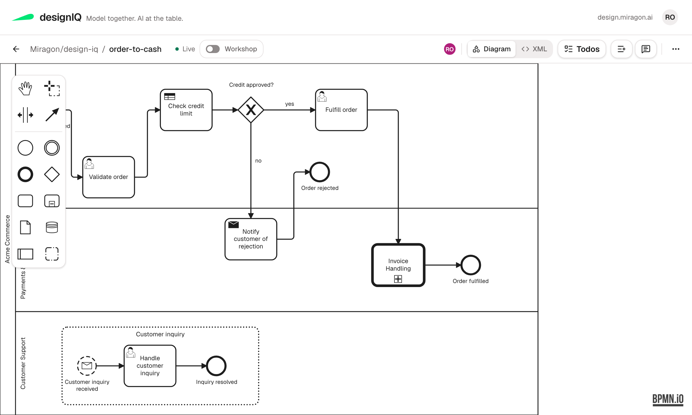

## One container to try it

The evaluation container runs without login and serves the example models, such as the
process `order-to-cash`. Start it with one `docker run`, open the model in the browser and
connect Claude Code to the same live model: [Getting started](./getting-started.md).

## Run it for your team

- [Self-hosting](./on-prem/): the image, the Compose reference, reverse proxy, data and
  backup. Users sign in at your OIDC identity provider, and your own GitHub App decides who
  may write to which repo.
- [MCP integration](./mcp-integration.md): the read-only MCP server for any checkout, the
  live `/mcp` endpoint of the host, its tools and the modelers that open inside the chat.
- [Upgrading to 5.0](./upgrading-to-5.md): the rename to designIQ and what to change, in
  order.

## Build on it

- [Connectors](./extending/connectors.md): a GitLab or Jira connector is a new adapter
  against the existing ports, not a fork.
- [SSO](./extending/sso.md) and [IdP setup for MCP clients](./extending/mcp-idp-setup.md):
  how login and tokens reach the host.
- [Decision records](./adr/): why the platform works the way it does.
